# ICE-X "GOD TIER" SYSTEM ARCHITECTURE & MASTER SPECIFICATION
**Project:** ICE-X — AI-Enabled Antarctic Sea-Ice Concentration Forecasting, Iceberg Drift Prediction & Maritime Navigation Decision Support System  
**Target:** Smart India Hackathon (SIH) Problem Statement 26059  
**Stakeholders:** Ministry of Earth Sciences (MoES) / National Centre for Polar and Ocean Research (NCPOR), Goa  
**Scientific Review Version:** 2.0 (Post-Audit Defensible Edition)

---

## 1. Operational Mission & Context

### 1.1 Vessel & Mission Profile
* **Vessel Designation:** `RV MAITRI-01` (Representative Indian Antarctic Research & Resupply Vessel profile).
* **Vessel Class:** IMO Polar Class PC5 (Year-round operation in medium first-year ice which may include old ice inclusions; hull yield stress limit $\approx 350\text{ MPa}$).
* **Mission:** 45th Indian Scientific Expedition to Antarctica (ISEA) Resupply & Science Voyage.
* **Voyage Origin:** Open Southern Ocean staging coordinates `[-62.45°S, 28.30°E]`.
* **Destination:** India's Maitri Antarctic Research Station, Schirmacher Oasis, Queen Maud Land `[-70.77°S, 11.73°E]` (NPDC official coordinates: $\approx 70^\circ 45' 52''\text{S}, 11^\circ 44' 03''\text{E}$).

### 1.2 The Tactical Conjunction Threat: Iceberg A-23A
* **Target:** Megaberg **A-23A** (tabular ice mass $\approx 3,900\text{ km}^2$, thickness $\approx 400\text{ m}$, mass $\approx 1.1 \times 10^{12}\text{ metric tons}$).
* **Observed Motion:** Drifting NNW at $0.82\text{ kt}$ ($342^\circ\text{ T}$) driven by the Antarctic Coastal Current and katabatic wind drag.
* **Conjunction Reality:** The direct great-circle corridor (**Route Alpha**) intersects A-23A's projected path with a Closest Point of Approach (**CPA**) of **$1.8\text{ nm}$ at $T+18.4\text{ hours}$**.
* **Safety Threshold Standard:** This breaches the **$10.0\text{ nm}$ configured operational safety buffer** (a mission-configurable safety perimeter established by the expedition master based on vessel radar detection horizon in heavy sea clutter, blind-sector masking, and berg drift uncertainty corridors).

---

## 2. The Three Types of Truth (System Philosophy)

To guarantee credibility before technical evaluators, ICE-X maintains strict ontological separation across three data layers:

```
┌─────────────────────────────────────────────────────────────────────────────┐
│ 1. OBSERVED DATA (Empirical Truth)                                          │
│    Real satellite radiometry (NOAA/NSIDC CDR v6), SAR radar (Copernicus     │
│    Marine SEAICE_ANT_PHY_AUTO_L3_NRT), USNIC Iceberg Catalogue, and GTS     │
│    ECMWF ERA5 reanalysis fields. Every data point has explicit timestamp.   │
├─────────────────────────────────────────────────────────────────────────────┤
│ 2. FORECAST DATA (Physics & Spatio-Temporal ML Models)                       │
│    Forward projections (+12h, +24h, +48h) generated by numerical sea-ice    │
│    thermodynamics/advection models and calibrated iceberg drift equations, │
│    accompanied by quantified spatial uncertainty envelopes (error cones).    │
├─────────────────────────────────────────────────────────────────────────────┤
│ 3. RECOMMENDED DATA (Decision Intelligence & Pareto Optimizations)         │
│    Algorithmically generated routing alternatives with multi-objective      │
│    cost trade-offs, presented as:                                           │
│    "RECOMMENDED — AWAITING OPERATOR APPROVAL".                              │
└─────────────────────────────────────────────────────────────────────────────┘
```

---

## 3. End-to-End Scientific Architecture Pipeline

```mermaid
flowchart TD
    subgraph S1["1. Raw Data Ingestion (Observed Data)"]
        D1["Satellite Radiometry & SAR<br/>(Copernicus / Sentinel-1 / NOAA CDR)"]
        D2["Ocean Surface Currents<br/>(CMEMS Global Ocean 1/12°)"]
        D3["Atmospheric Winds & Temp<br/>(ECMWF ERA5 / GFS Reanalysis)"]
        D4["Iceberg Positions & Geometry<br/>(USNIC Antarctic Iceberg Catalogue)"]
    end

    subgraph S2["2. Spatial Normalization"]
        N1["Polar Stereographic Grid Engine<br/>(EPSG:3031 Antarctic Projection @ 1km / 25km)"]
    end

    subgraph S3["3. Predictive Forecasting Engines"]
        M1["Sea-Ice Concentration Forecast Engine<br/>(Advection-Diffusion + Thermodynamic Growth/Melt)"]
        M2["Iceberg Drift Physics & Uncertainty Model<br/>(Wind Drag + Current Drag + Coriolis + Form Drag)"]
    end

    subgraph S4["4. Hazard & Constraint Quantifier"]
        H1["Spatial Conjunction Engine (CPA & TCPA)"]
        H2["Polar Class PC5 Structural Hull Limit (SIC ≤ 60%)"]
        H3["ISO 15016 Deterministic Bunker Fuel Model"]
    end

    subgraph S5["5. Multi-Objective Route Optimizer"]
        R1["Constrained A* Graph Search over Ice-Cost Grid"]
        R2["Pareto Decision Matrix<br/>(Route Alpha: Blocked | Route Bravo: Optimal | Route Charlie: Fuel Limit)"]
    end

    subgraph S6["6. Explainable AI & Decision Intelligence"]
        A1["Domain Agent Deliberation Deck<br/>(IceNav, BergWatch, PolarMet, Propulsion, SafetyGate)"]
    end

    subgraph S7["7. Human Operator Safety Gate"]
        G1["STATUS: RECOMMENDED — AWAITING OPERATOR APPROVAL"]
        G2["Operator Authorization Button ➔ Waypoints Released to Bridge"]
    end

    S1 --> S2 --> S3 --> S4 --> S5 --> S6 --> S7
```



---

## 4. Mathematical & Physical Models

### 4.1 Sea-Ice Concentration Forecasting Model
Sea-ice concentration $C(x, y, t) \in [0, 1]$ satisfies the 2D conservative transport-diffusion equation coupled to thermodynamic growth/melt:

$$\frac{\partial C}{\partial t} + \nabla \cdot (C \, \vec{u}_{\text{ice}}) = K_h \nabla^2 C + S_{\text{thermo}}$$

Where:
* $\vec{u}_{\text{ice}} = \alpha_w \mathbf{R}(\theta_w) \vec{u}_{\text{wind}} + \alpha_c \vec{u}_{\text{ocean}}$ is the free-drift sea-ice velocity (wind drift factor $\alpha_w \approx 0.02$, turning angle $\theta_w \approx 28^\circ$ left in the Southern Hemisphere).
* $S_{\text{thermo}} = \frac{1}{\rho_i L_f} \left( Q_{ai} + Q_{oi} \right)$ represents thermodynamic growth or melt derived from air temperature and sea surface temperature anomalies.
* $K_h$ is the horizontal eddy diffusivity.

### 4.2 Iceberg A-23A Dynamic Drift Model & Uncertainty Propagation
The momentum equation for a tabular iceberg of mass $M$ with added mass $M_a = 0.5 M$:

$$(M + M_a) \frac{d\vec{v}_b}{dt} = - (M + M_a) f (\vec{k} \times \vec{v}_b) + \vec{F}_a + \vec{F}_w + \vec{F}_{wp} + \vec{F}_{si}$$

Where:
* Coriolis parameter: $f = 2\Omega \sin(\phi)$ ($\phi \approx -65^\circ$).
* Atmospheric air drag: $\vec{F}_a = \frac{1}{2} \rho_a C_a A_a |\vec{v}_a - \vec{v}_b| (\vec{v}_a - \vec{v}_b)$.
* Hydrodynamic ocean drag: $\vec{F}_w = \frac{1}{2} \rho_w C_w A_w |\vec{v}_w - \vec{v}_b| (\vec{v}_w - \vec{v}_b)$.
* $\vec{F}_{wp}$ is the ocean surface wave radiation pressure force; $\vec{F}_{si}$ is sea-ice resistance force.

#### Propagated Spatial Uncertainty Envelope (Error Cone):
Rather than an arbitrary percentage, the iceberg's position covariance matrix $\mathbf{\Sigma}(t)$ propagates forward in time according to wind/current forecast uncertainty:

$$\mathbf{\Sigma}(t) = \mathbf{\Sigma}_0 + \mathbf{Q}_{\text{wind}} \cdot t^2 + \mathbf{Q}_{\text{ocean}} \cdot t^2$$

This yields an expanding semi-major error ellipse:
* **$T + 12\text{h}$:** $\pm 2.1\text{ nm}$ dispersion radius.
* **$T + 24\text{h}$:** $\pm 5.4\text{ nm}$ dispersion radius.
* **$T + 48\text{h}$:** $\pm 11.8\text{ nm}$ dispersion radius.

### 4.3 Deterministic Vessel Fuel Consumption Model
Total bunker fuel consumption over voyage path $\mathcal{P}$ is calculated deterministically using Holtrop-Mennen resistance principles:

$$F_{\text{total}} = \int_{\mathcal{P}} \text{SFC} \cdot \left[ P_{\text{calm}}(v) + \Delta P_{\text{wind}}(\vec{v}_{\text{rel}}) + \Delta P_{\text{waves}}(H_s) + \Delta P_{\text{ice}}(SIC, h_{\text{ice}}) \right] \frac{ds}{v}$$

* $P_{\text{calm}}(v)$: Hydrodynamic bare-hull propulsion power at vessel speed $v$.
* $\Delta P_{\text{ice}}(SIC, h_{\text{ice}}) = k_{\text{ice}} \cdot SIC^2 \cdot h_{\text{ice}}^{1.5}$: Continuous ice-crushing and submergence power penalty.
* $\text{SFC} \approx 185\text{ g/kWh}$: Specific Fuel Consumption for medium-speed marine diesel engines.
* **Why Route Charlie Fails:** Route Charlie routes into ice-free water ($0\%\text{ SIC}$), but incurs an additional $212\text{ nm}$ detour fighting violent Southern Ocean swell ($H_s = 4.8\text{ m}$), generating a **$+42.8\text{ MT}$ bunker fuel penalty** and breaching the vessel's mandatory $25.0\%$ emergency arrival reserve floor.

### 4.4 Grid-Based Multi-Objective Route Optimization (Constrained A*)
Candidate corridors are derived using graph search (A*) over a discrete Polar Stereographic grid:

$$\min_{\mathcal{P}} \mathcal{J}(\mathcal{P}) = \int_{\mathcal{P}} \left( w_1 + w_2 \frac{dF}{ds} + w_3 \mathcal{R}_{\text{ice}}(SIC) + w_4 \mathcal{R}_{\text{berg}}(d_{\text{CPA}}) \right) ds$$

**Subject to hard safety gates:**
1. Hull Structural Ceiling: $\max(SIC) \le 60\%$ (mandatory Polar Class PC5 structural limit).
2. Operational Proximity Buffer: $d_{\text{CPA}}(\text{A-23A}) \ge 10.0\text{ nm}$.
3. Mandatory Reserve Floor: $\text{Fuel}_{\text{arrival}} \ge 25.0\%$.

---

## 5. Candidate Route Evaluation Matrix

| Parameter | Route Alpha (Direct Corridor) | Route Bravo (Optimal Arc) | Route Charlie (Detour Corridor) |
| :--- | :--- | :--- | :--- |
| **Strategy** | Direct rhumb-line corridor | Arcs through pack-ice leads | Detours into open Southern Ocean |
| **Total Distance** | $684\text{ nm}$ | $742\text{ nm}$ ($+8.5\%$) | $896\text{ nm}$ ($+31.0\%$) |
| **Transit Duration** | $55.2\text{ hours}$ | $62.8\text{ hours}$ ($+7.6\text{h}$) | $78.4\text{ hours}$ ($+23.2\text{h}$) |
| **Bunker Consumption**| $28.4\text{ MT}$ | $31.2\text{ MT}$ ($+2.8\text{ MT}$) | $42.8\text{ MT}$ ($+14.4\text{ MT}$) |
| **Iceberg A-23A CPA** | **$1.8\text{ nm}$ (CRITICAL BREACH)** | **$18.4\text{ nm}$ (SAFE CLEARANCE)** | **$48.2\text{ nm}$ (WIDE CLEARANCE)** |
| **Peak Ice Exposure** | $78\%\text{ SIC}$ (Breaches limit) | $35\%\text{ SIC}$ (Sub-critical) | $0\%\text{ SIC}$ (Clear open water) |
| **Arrival Fuel Reserve**| $43.9\%$ | $41.1\%$ | **$14.2\%$ (BREACHES 25% FLOOR)** |
| **Status Gate** | **UNVIABLE · CONJUNCTION** | **RECOMMENDED (AWAITING AUTH)**| **UNVIABLE · FUEL DEFICIT** |

---

## 6. Integrating `gods-eye-view` Without Gimmicks

We selectively adapt techniques from `bilawalsidhu/gods-eye-view` to enhance operational utility while maintaining scientific restraint:

1. **Simulated Vessel Radar Layer (X-Band Inspired):**
   * *Not* claimed as physical radar hardware; explicitly presented as a *simulated shipboard marine radar overlay* with 12 nm range rings and rotating sweep beam that highlights floe proximity.
2. **Sentinel-1 SAR Derived Visualization:**
   * Grounded in Copernicus synthetic aperture radar backscatter data ($1\text{ km}$ resolution) to demonstrate how radar penetrates Antarctic cloud cover and polar winter night.
3. **Bridge-Wing Perspective (`V` Key):**
   * Mounts the camera onto *RV MAITRI-01*'s bridge wing, facing forward over the bow, providing immediate immersion for assessing visual lookout limits.
4. **Cinematic Route Corridor Flyover (`F` Key):**
   * Follows the 3D Great Circle arc of Route Bravo to visually demonstrate why arcing through pack-ice leads safely bypasses Iceberg A-23A.
5. **Tactical Conjunction Reticles:**
   * Screen-space HUD brackets `[ A-23A ]` that project live range, bearing, and CPA over the 3D globe without label overlap or clipping.

---

## 7. Strict UI Invariants & Color Theory
* **Monochromatic Arctic Palette:** Strictly no neon reds, oranges, or yellows.
* **Palette:**
  * Clean Polar Sky Blue: `#edf6fd`, `#f0f7fe`
  * Deep Oceanic Navy: `#0f2942`, `#0c4a6e`, `#0369a1`
  * Celestial Cyan Accents: `#0284c7`, `#38bdf8`
  * Muted Steel Slate: `#475569`, `#64748b`, `#334155`
* **Typography:** Clean, natural **Outfit** font family.
