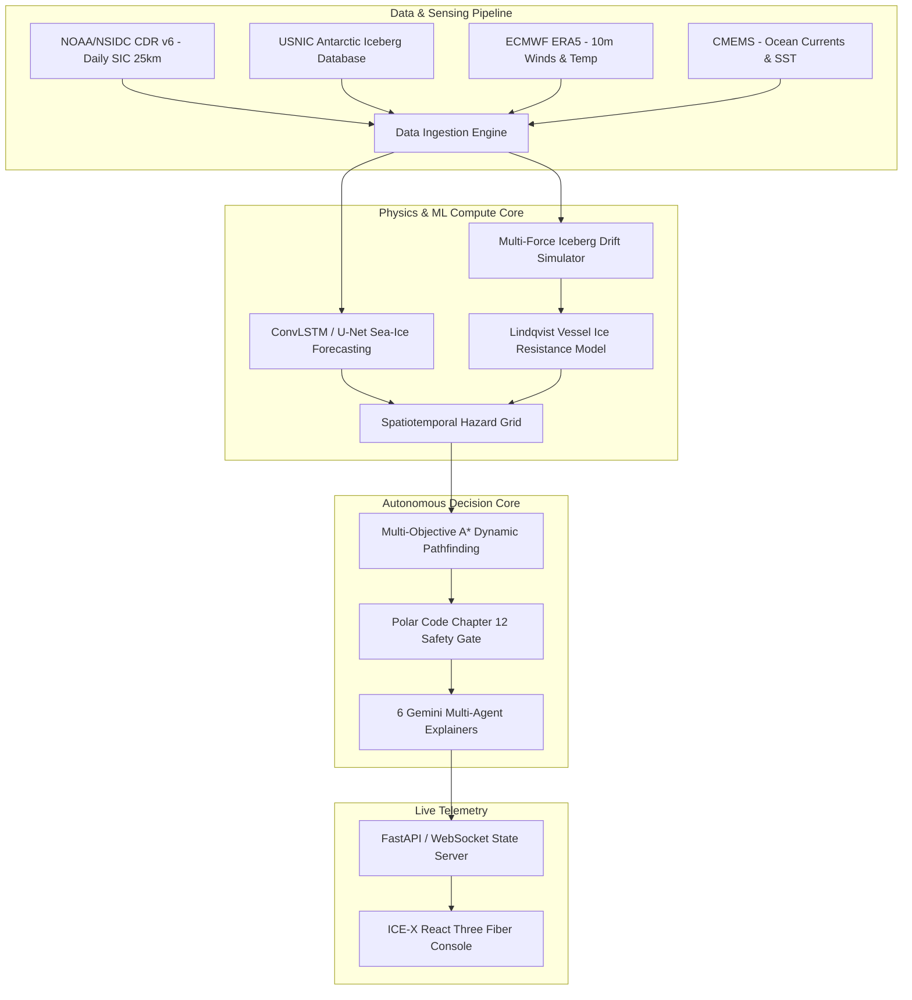

# ICE-X: Project State & Tomorrow's Engineering Blueprint

**Project Title**: AI-Enabled Antarctic Sea-Ice, Iceberg Trajectory, and Navigation Decision Support System  
**SIH Problem Statement**: 26059 | **Ministry**: MoES / NCPOR (National Centre for Polar and Ocean Research)  
**Workspace**: `c:\Users\wildr\OneDrive\Desktop\ICE`  
**Current Date**: September 26, 2026  
**Status**: UI/UX Foundation Complete & Polished ✅ | Backend System Implementation Ready for Tomorrow 🚀  

---

## 1. Work Completed Tonight (Frontend & 3D Polar Console)

### A. Authentic 3D Earth Globe & Antarctic Operating Theater
* **NASA Blue Marble Imagery**: High-definition satellite texture (`/earth-blue-marble.jpg`) showing true Earth oceans, continents, cloud systems, and the snow-covered Antarctic continent in the center.
* **360° Free Mouse Drag Rotation**: Eye-level orbital camera placement (`[0, 6, 36]`) with center-locked target (`enablePan={false}`), eliminating pole lock and allowing silky smooth, unrestricted rotation around the entire planet.
* **Extended Dynamic Zoom**: Range from `14.8` (close-up inspection of ice leads, vessel maneuvers, and iceberg keels) to `90.0` (deep-space orbital view).
* **Geographic Sea-Ice Concentration (SIC)**: Dynamic layer surrounding Antarctica with dedicated gradient legend (0% Open Water $\rightarrow$ 100% Consolidated Pack).
* **Research Vessel (`SA Agulhas III`)**: 3D technical marker with forward-scanning 12 nm ice radar sweep arc and clean minimal HUD pill (`SA Agulhas III · 12.4 kt`).
* **Tracked Icebergs**: `A-23A` rendered with active **10 nm proximity hazard perimeter circle**, drift trajectory vector, and closest-approach alert.
* **Dominant Navigation Routes**: Route Bravo rendered as a luminous emerald ribbon with **animated directional photon pulses** flowing toward Maitri Station; Route Alpha marked with collision cross.

### B. Light Polar Sky Aesthetic & Color Theory Harmonization
* **Monochromatic Antarctic Palette**: Replaced harsh terminal darks and random circus colors (pinks, reds, oranges) with a cohesive, professional palette of **deep marine navy (`#0f2942`, `#0c4a6e`), polar sky blue (`#edf6fd`, `#f0f7fe`), and muted steel slate (`#64748b`)**.
* **Soft Sky-Tinted Glass Panels**: Replaced pure whites with `rgba(238, 246, 254, 0.88)` and subtle frost borders `rgba(215, 235, 252, 0.95)`.
* **Human-Crafted Typography**: Integrated the **Outfit** and **Space Grotesk** font families with natural sentence casing and normal font weights (`font-normal`, `font-medium`), completely eliminating AI-style shouting caps.
* **Non-Overlapping 3D HUD Tags**: Clean, minimal rounded pills with `pointerEvents="none"` so clicks always pass through to rotate the Earth.

### C. Maritime Decision Intelligence & Compliance Gauges
* **Full-Height Scrollable Panel**: Resolved the layout clipping issue with `top-16 bottom-12`, pinned header, pinned action footer, and independent `flex-1 min-h-0 overflow-y-auto` scrolling.
* **Polar Code Safety Telemetry Matrix**: Active constraint monitoring deck featuring live margin gauges and threshold pins:
  1. *Iceberg CPA Buffer*: `18.4 nm` vs `10.0 nm` threshold (`+8.4 nm safe margin`).
  2. *Sea-Ice Concentration*: `35% SIC` vs `60% PC5 limit` (`-25% under ceiling`).
  3. *Arrival Bunker Fuel*: `41.1%` vs `25.0% mandatory floor` (`+16.1% over floor`).
  4. *Wave Slamming Severity*: `3.2 m Hs` vs `6.5 m limit` (`-3.3 m sub-critical`).
* **Evaluated Alternative Corridors**: Selectable technical cards detailing the exact physics why the algorithm rejected them:
  * *Route Alpha*: Conjunction alert at CPA `1.8 nm at T+18.4h` (violates 10 nm radar perimeter).
  * *Route Charlie*: Zero ice contact (`0% SIC`), but `+42.8 MT bunker penalty` causing arrival reserve to drop to `14.2%` (breaches 25% floor).

---

## 2. Master System Implementation Plan (For Tomorrow)

Per the approved 25-point architecture roadmap (benchmarked against StellarX engineering standards), tomorrow we transition from mock telemetry to the **Real-Time Physics, ML & Multi-Agent Backend**:



### Tomorrow's Execution Phases:
1. **Phase 1: Backend Scaffolding & EventBus**
   - Initialize Python FastAPI / Node stateful backend with deterministic 10Hz simulation clock.
   - Establish typed EventBus (`VESSEL_TELEMETRY`, `BERG_PROPAGATED`, `SIC_GRID_UPDATED`, `ROUTE_RECOMPUTED`).
2. **Phase 2: Real Data Ingestion Engine**
   - Ingest NOAA/NSIDC polar stereographic grids and convert to GeoTIFF/NumPy arrays.
   - Parse USNIC weekly iceberg shapefiles into tracked state vectors.
   - Stream ERA5 wind vectors and Copernicus surface current fields.
3. **Phase 3: Sea-Ice Forecasting ML Engine**
   - Implement ConvLSTM / U-Net spatial forecasting on historical SIC grids with wind covariates.
   - Output 24h, 48h, 72h predicted ice expansion rasters.
4. **Phase 4: Multi-Force Iceberg Drift Physics**
   - Implement Newtonian drift integration:
     $$M \frac{d\vec{V}}{dt} = \vec{F}_{\text{air}} + \vec{F}_{\text{water}} + \vec{F}_{\text{coriolis}} + \vec{F}_{\text{ice}} + \vec{F}_{\text{wave}} + \vec{F}_{\text{tilt}}$$
   - Generate predicted trajectory cones with uncertainty envelopes.
5. **Phase 5: Lindqvist Vessel Ice Resistance & Dynamics**
   - Model hull resistance in level ice, brash ice, and open water based on vessel Polar Class (PC5).
   - Compute dynamic fuel burn rate: $\text{Fuel} = \int (P_{\text{open}} + P_{\text{ice}}(\text{SIC}, h_{\text{ice}})) \, dt$.
6. **Phase 6: Multi-Objective Dynamic Route Optimization**
   - Implement A* / D* Lite on a dynamic 4D spatiotemporal cost grid $(x, y, z, t)$.
   - Pareto optimization balancing transit time, bunker fuel consumption, and risk of besetment.
7. **Phase 7: Polar Code Safety Enforcement Gate**
   - Deterministic rule engine enforcing IMO Polar Code Chapter 12:
     - `MIN_BERG_CLEARANCE = 10.0 nm`
     - `MAX_ALLOWABLE_SIC = 60% (PC5)`
     - `FUEL_RESERVE_FLOOR = 25.0%`
     - `WAVE_SEVERITY_LIMIT = 6.5 m Hs`
8. **Phase 8: Multi-Agent Decision Intelligence (6 Domain Specialists)**
   - *IceNav*: Ice floe convergence and lead detection.
   - *BergWatch*: Drift trajectory conjunction tracking.
   - *PolarMet*: Katabatic wind and blizzard warnings.
   - *PropulsionChief*: Engine load and bunker consumption.
   - *SafetyGate*: Strict regulatory veto authority.
   - *ExpeditionLead*: Resupply schedule and mission synthesis.
9. **Phase 9: Live WebSocket Telemetry Pipeline**
   - Connect the React console to the live WebSocket server, replacing mock state with real physics.
10. **Phase 10: Validation & Benchmarking Suite**
    - Verification benchmarks against historical Antarctic voyages (MAE, RMSE, IoU).

---

## 3. How to Run & Resume

```bash
# 1. Open the project folder
cd c:\Users\wildr\OneDrive\Desktop\ICE

# 2. Start the development server
npm run dev

# 3. Open in browser
http://localhost:5173/
```

All source files, textures, design tokens, and components are permanently stored in `c:\Users\wildr\OneDrive\Desktop\ICE`. Sleep well, and we will build the backend tomorrow!
